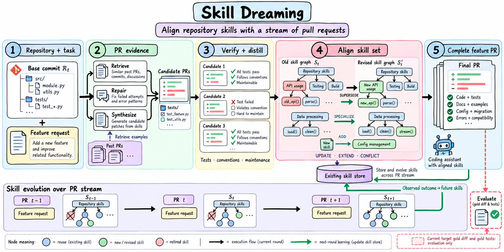

<h1 align="center">Skill Dreaming</h1>

<p align="center">
  <strong>Learning from pull requests to extend and maintain evolving repositories.</strong>
</p>

<p align="center">
  
</p>



Pull requests capture more than code changes. They reveal how features fit into a repository, which abstractions to reuse, and what testing, documentation, configuration, or compatibility work a complete change requires. **Skill Dreaming** turns these development records into reusable, repository-specific skills. For each new request, it draws on the current repository, earlier PRs, and existing skills to generate and align the skills needed for implementation and maintenance. Subsequent PR outcomes inform the next round of updates, allowing the skill library to evolve with the repository while model weights remain fixed.

## Workflow

The verified-learning workflow follows a sequential loop:

1. **Retrieve relevant PR records.** Identify code relevant to the request and retrieve earlier PRs. Exclude the held-out target PR and any records unavailable at the time of the request.
2. **Construct and verify candidate changes.** Reuse historical patterns, repair outdated approaches, or synthesize a new implementation. Run repository tests and configured checks before treating a candidate as a successful record for skill learning.
3. **Distill and align skills.** Extract reusable procedures, constraints, maintenance requirements, and validation steps. Compare them with existing skills to decide what to retain, revise, extend, specialize, or replace, and identify incompatible rules.
4. **Retrieve and inject applicable skills.** Select relevant active skills, filter out stale records, and prevent conflicting alternatives from being used together. Fit complete skill instructions within the available context budget.
5. **Implement, maintain, and learn.** Use the selected skills to produce the feature and its associated maintenance changes. Check the result, attempt repair within the allotted budget, and record outcomes and skill usage for subsequent requests.

The active skill pool is bounded. Replaced skills and records removed to meet the capacity limit are archived, preserving their history and the decisions behind each update. Pool capacity, the number of retrieved skills, and the size of the injected context are controlled separately.

## Install

Python 3.10 or later and Git are required.

```bash
git clone https://github.com/Hik289/skill-dreaming.git
cd skill-dreaming
python3 -m venv .venv
source .venv/bin/activate
python -m pip install -e .
skill-dream --help
```

## Use

Start with an existing Git repository and a task manifest ordered by time. Initialize a skill store for that repository, optionally populate it from accepted historical PRs, and replay the requests in sequence.

**Default replay** generates a patch from the recorded base checkout and previously learned skills. It evaluates the patch before learning from the observed target PR, making those skill updates available only to **later requests**. Candidate plans are ranked heuristically; selecting a plan does not verify an implementation.

**Verified learning** constructs and tests candidate changes, then distills and aligns skills **before the final implementation**. The final coding agent receives the resulting skill instructions, not a completed candidate patch to copy. The held-out target change remains unavailable until final evaluation is complete.

In both modes, each task starts from its recorded repository state. Generated patches are not automatically merged or carried forward as the next task's base. See [Running the code](docs/reproduction.md) for input formats, temporal filtering, benchmark setup, and optional drivers.

Run generated code in a suitably restricted environment. A Git worktree separates working copies; it is not a security sandbox.

## Configure

Use [.env.example](.env.example) and [configs/agent.example.json](configs/agent.example.json) as configuration templates. Choose models and configure provider access locally; keep credentials, datasets, and generated outputs out of version control. Detailed setup instructions are in [Running the code](docs/reproduction.md). Model-backed runs may incur provider charges, while the offline checks below make no model calls.

## Code Layout

| Path | Purpose |
| --- | --- |
| `skill_dream/skill_store.py` | Skill storage, relationships, retrieval, usage tracking, and archival |
| `skill_dream/skill_context.py` | Source-date filtering, conflict handling, and context-limited skill injection |
| `skill_dream/workflow.py` | Candidate construction and verification, maintenance planning, and bounded repair |
| `skill_dream/pipeline.py` | Sequential task replay, patch evaluation, and outcome recording |
| `verified_a2_driver.py`, `verified_a2_driver_sonnet.py` | SWE-bench Verified patch generation with separate local skill pools |
| `verified_external_driver.py` | Method-inspired retrieval adapters, not official method implementations |
| `verified_eval.py`, `verified_eval_iso.py` | Wrappers for the official SWE-bench Verified evaluation harness |
| `miniagent/rebuild_a2_driver.py` | SWE-bench Pro patch generation |
| `scripts/legacy/` | Historical pool-building and analysis utilities; some require external adapters |
| `scripts/release_check.py` | Checks for exposed credentials, private paths, concrete model IDs, and excluded release files |
| `tests/` | Offline tests for temporal filtering, skill persistence, workflow behavior, and release checks |

The [Skill dataclass](skill_dream/skill_store.py) defines how skills are stored. Alignment supports seven operations: `ADD`, `UPDATE`, `SPECIALIZE`, `EXTEND`, `CONFLICT`, `SUPERSEDE`, and `KEEP`. Proposed operations are validated before they are applied; invalid decisions fall back to adding a new skill or updating an existing one. Replacing a skill requires an explicit replacement relation and a later source date, not merely overlapping keywords. Conflicting alternatives remain in the store but are not injected together.

## Check the Code

Run the release checks, offline tests, and command-line help:

```bash
python scripts/release_check.py --staged
python -m unittest discover -s tests -v
python -m skill_dream.cli --help
```
