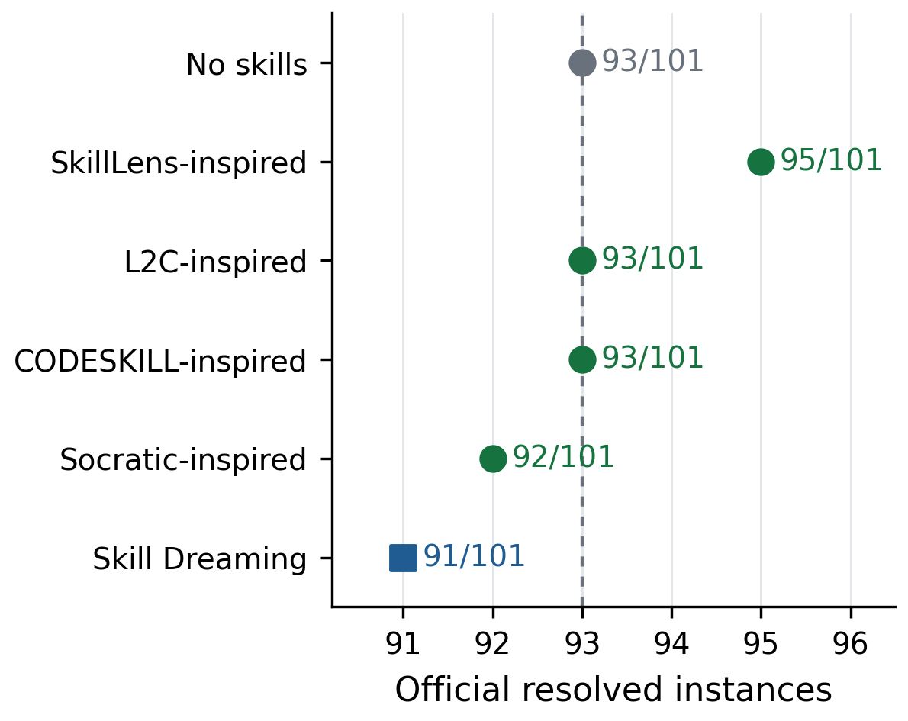
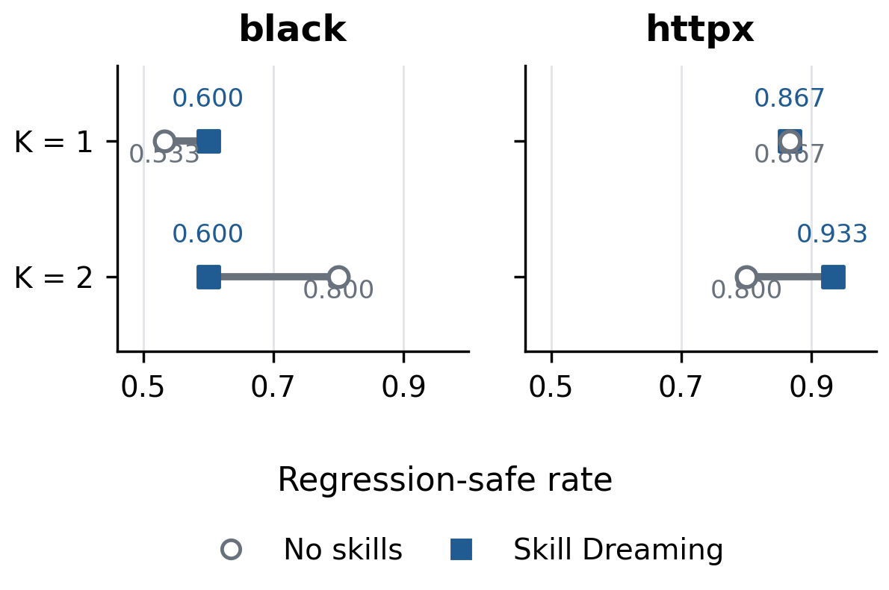
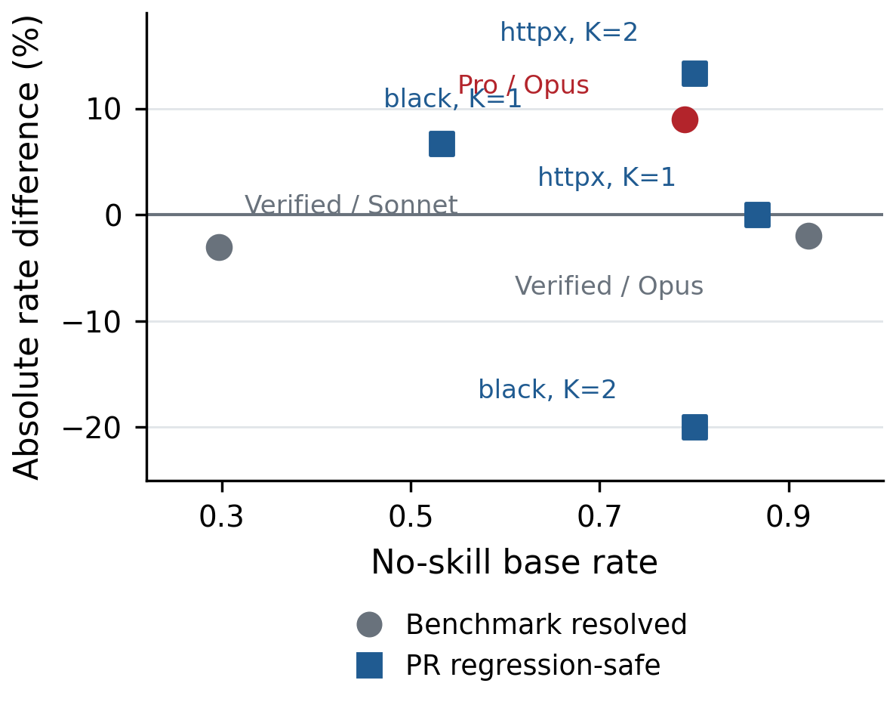

# Results and Metric Definitions

These tables transcribe the corrected experiment ledger supplied with the project. They are historical measurements, not results rerun during release preparation. All runs are single seed. The supplied source package contains summarized results but not the full per-instance predictions, target manifests, skill pools, or every experiment runner.

The experiment label **Opus-5.5** is retained verbatim. Configure a valid model ID for your provider separately. Do not combine different backbones, retrieval configurations, candidate budgets, benchmark subsets, or evaluable denominators.

## Metric Definitions

| Metric | Definition and reporting rule |
| --- | --- |
| Official resolved rate | Number of instances marked `resolved=true` by the benchmark's official harness divided by the evaluated target count. Report unresolved, errored, and missing-report counts separately. The headline Verified table has 101/101 reports and zero reported harness errors. |
| Resolved difference | Full resolved rate minus base resolved rate on the same task set. When displayed with `%`, compute `100 * (full_rate - base_rate)`; this is an absolute rate difference, not relative growth. |
| Paired significance | Two-sided exact McNemar/binomial test using only base-only and full-only successes. Seed uncertainty and benchmark-subset uncertainty are not captured by this test. |
| Existing tests pass | For the corrected click pilot, no new failures relative to the base test result. This is regression safety, not evidence that the requested feature works. The bundled basic replay instead uses its executed pytest result directly. |
| Gold PR tests pass | All designated task-specific gold PR tests pass. click headline rates use 14 gold-evaluable PRs; four PRs without runnable gold tests are excluded and must be reported. |
| Basic replay task success | `patch_applies_clean AND existing_tests_pass` in `pipeline.py`. This proxy is distinct from official resolved and from gold-test task success. |
| Maintenance Surface F1 | Map changed file paths to surface categories. For predicted category set `P` and gold category set `G`, precision is `|P intersect G| / |P|`, recall is `|P intersect G| / |G|`, and F1 is their harmonic mean. Aggregate per-task scores. `evaluator.py` defines empty-set behavior. This measures category coverage, not semantic correctness. |
| Per-type surface recall | Among PRs whose gold changes include a given surface type, the fraction whose generated patch includes that type. Report the eligible count per type; absent gold types are `n/a`. |
| Surface precision | Fraction of distinct predicted surface categories present in the gold category set. It is not the fraction of correctly edited files. |
| Off-gold file count | Number of generated file paths not in the gold changed-file set; the bundled helper also reports their surface classes. This is not automatically an error, because valid alternative implementations can edit different files. |
| Gold in Top-k | Fraction of eligible tasks for which at least one gold localization target is among the first k retrieved units. |
| Recall@k | Fraction of eligible gold units retrieved in the first k positions, computed per task and aggregated. New symbols absent from the base repository need a separate denominator. |
| MRR | Mean reciprocal rank of the first relevant localization unit; zero when no relevant unit is retrieved. |
| Tokens / success | Sum of input and output tokens over the stated run scope divided by successful tasks. Report zero-success cases as undefined and specify whether offline skill distillation is included. |
| Wall time | Elapsed wall-clock time for the stated stage or full run, with concurrency and offline preparation exclusions disclosed. Historical tables lacking those details should not be used for exact deployment-cost predictions. |

Some ledger columns, including repository alignment, selection accuracy, skill pollution, reuse precision, and relation judgments, lack a complete bundled scoring implementation or trace. Their historical values are reported with that limitation; the release does not assign a new mathematical definition retroactively. Stale-filter counts are not stale-use error rates. Filtering a fraction of retrieved skills is not detection recall without labeled stale/non-stale ground truth.

## Experiment 1: Repository Update Quality

### Official Benchmark Subsets

| Benchmark | Backbone label | n | Base resolved | Full resolved | Difference | Exact paired p |
| --- | --- | ---: | ---: | ---: | ---: | ---: |
| SWE-bench Pro, ansible/qutebrowser/openlibrary | Opus-5.5 | 100 | 79 (0.790) | 88 (0.880) | +9.0% | 0.0117 |
| SWE-bench Verified, 12 repositories | Opus-5.5 | 101 | 93 (0.921) | 91 (0.901) | -2.0% | 0.625 |
| SWE-bench Verified, historical run | Sonnet | 101 | 30 (0.297) | 27 (0.267) | -3.0% | Not supplied |

Pro has 10 full-only versus one base-only success. Verified at Opus has 90 shared successes, three base-only successes, one full-only success, and seven shared failures. These are different benchmark instances. The comparison is compatible with several explanations, including headroom, evidence quality, retrieval fit, and task mix; it does not isolate those explanations causally.

The released A2 benchmark drivers use **dense cosine top-8 retrieval with threshold 0.20**, not the click hybrid retriever. Benchmark-specific raw trajectories and exact split files are absent.

### External Adapters on Verified

| Method | Resolved / 101 | Rate | Difference in resolved count vs base |
| --- | ---: | ---: | ---: |
| Base | 93 | 0.921 | 0 |
| SkillLens-inspired adapter | 95 | 0.941 | +2 |
| Learning to Commit-inspired adapter | 93 | 0.921 | 0 |
| CODESKILL-inspired adapter | 93 | 0.921 | 0 |
| Socratic-SWE-inspired adapter | 92 | 0.911 | -1 |
| Skill Dreaming, A2 | 91 | 0.901 | -2 |

The external adapters share the mini-agent harness but only approximate aspects of the named methods. For example, the CODESKILL adapter ranks by confidence and keyword relevance; the Socratic adapter injects a fixed self-questioning guide. These are not faithful reproductions of trained or self-evolving author systems. No paired p-values are supplied for the external rows, so their significance should not be inferred from aggregate rates alone.

### click Headline Pilot

18 PRs, one seed; hybrid BM25+dense retrieval, a prebuilt skill pool, and regression-based best-of-K selection. Gold-test results use the 14-PR evaluable subset.

| Configuration | Existing tests pass | Surface F1 | Repo alignment, historical score | Gold PR tests pass |
| --- | ---: | ---: | ---: | ---: |
| Base, K=1 | 0.833 | 0.620 | 0.378 | 0.286 |
| Base, K=4 | 0.889 | 0.707 | 0.429 | 0.286 |
| Append-only, K=4 | 0.944 | 0.716 | 0.435 | 0.143 |
| Full, hybrid + K=4 | 1.000 | 0.737 | 0.443 | 0.143 |

The four rows improve in regression safety and surface coverage, but full and append-only are worse on gold tests. The ledger's headline mean-token figures are 19,098 / 77,263 / 96,881 / 92,017 respectively; another table labels these as tokens per success. Because the raw accounting is not bundled, that ambiguous cost column is not used for a normalized comparison here.

### PR Evidence Conditions

| Condition | Base Surface F1 | Full Surface F1 | Reported difference |
| --- | ---: | ---: | ---: |
| RealFlow | 0.704 | 0.624 | -0.081 |
| NoisyPR | 0.738 | 0.734 | -0.004 |
| SparsePR | 0.738 | 0.734 | -0.004 |
| OutdatedPR | 0.741 | 0.778 | +0.037 |
| NoPR | 0.638 | n/a, no pool | n/a |

These are a separate A2 run family, not the K=4 headline table. Most conditions have 18 PRs; OutdatedPR has nine. The RealFlow difference is retained at the ledger's precision and may differ by 0.001 from subtraction of rounded displayed means.

## Experiment 2: Audit and Localization

| Granularity / retriever | Top-1 | Top-3 | Recall@5 | Recall@10 | MRR | Eligible n |
| --- | ---: | ---: | ---: | ---: | ---: | ---: |
| File, TF-IDF | 0.642 | 0.896 | 0.924 | 0.960 | 0.771 | 106 |
| File, embedding | 0.340 | 0.453 | 0.481 | 0.731 | 0.459 | 106 |
| Module, TF-IDF | 1.000 | 1.000 | 0.986 | 0.986 | 1.000 | 106 |
| Module, embedding | 1.000 | 1.000 | 0.986 | 0.986 | 1.000 | 106 |
| Function, all gold symbols, TF-IDF | 0.100 | 0.156 | 0.081 | 0.081 | 0.132 | 90 |
| Function, modified symbols only, TF-IDF | 0.250 | 0.389 | 0.332 | 0.332 | 0.330 | 36 |

The ledger also describes a separate nine-PR base-source-symbol subset: function Top-1 0.222, Top-3 0.333, and MRR 0.341. Do not attach those values to the 90/36-denominator rows. The localization runner is not bundled, so exact sampling and aggregation cannot be reconstructed from this package alone.

The PR audit uses **LLM-constructed reference labels**, not human ground truth. On 42 PRs: accuracy 0.595, macro precision 0.238, macro recall 0.250, and macro F1 0.244. Supports are usable 21, repairable two, irrelevant 19, outdated zero, unsafe zero. An absent class has no estimable rejection recall; the ledger's zeros for outdated/unsafe must not be read as measured detection quality.

## Experiment 3: Candidate Synthesis and Selection

| Method / operating point | Task-success proxy | Surface F1 | Selection accuracy, historical score | Candidates / success | Tokens / success |
| --- | ---: | ---: | ---: | ---: | ---: |
| Single sample, K=1 | 0.944 | 0.799 | 0.833 | 1.0 | 26,894 |
| Best-of-K + full verifier, K=4 | 1.000 | 0.871 | 0.944 | 4.0 | 101,394 |
| Trace2Skill + local PR replay adapter | 0.778 | 0.596 | n/a | 1.0 | 26,946 |
| SkillLens-inspired composition | 0.611 | 0.709 | n/a | 1.0 | 14.3k |
| Skill Dreaming, K=4 | 1.000 | 0.871 | 0.944 | 4.0 | 101,394 |

click, 18 PRs, single seed. Candidate validity and diversity were not separately instrumented. Best-of-K and full share the same recorded operating point; this table alone does not isolate the contribution of each pipeline stage. Trace2Skill is described in the ledger as official code plus a local replay adapter; that external code/adapter is not bundled here.

## Experiment 4: Evidence Sources

| Evidence / adapter | Future task-success proxy | Reuse precision, historical score | Reply-to-skill accuracy | Negative-constraint precision | Trigger recall, historical score |
| --- | ---: | ---: | ---: | ---: | ---: |
| Positive PRs only | 0.889 | 0.671 | n/a | n/a | 0.778 |
| Review/reply only | 0.833 | 0.482 | 0.444 | 0.333 | 0.556 |
| Trace2Skill adapter | 0.722 | 0.671 | n/a | n/a | 0.778 |
| Socratic-inspired adapter | 0.833 | 0.671 | n/a | n/a | 0.778 |
| Full | 0.889 | 0.518 | 0.444 | 0.333 | 0.722 |

All rows are reported under the Opus experiment label. Reply faithfulness is 12/27 and negative-constraint grounding is 4/12, both assessed by an LLM judge. Positive-only and positive+negative variants both have task-success proxy 0.889 and Surface F1 0.749. This run provides no measured task-success improvement from adding negative evidence.

## Experiment 5: Relation and Rewrite Ablations

Separate hybrid + K=2 pilot, 18 PRs; gold task success uses 14 evaluable PRs.

| Variant | Gold task success | Existing tests | Surface F1 | Surface precision | Off-gold count/PR, historical pollution score | Stale filtered/PR | Superseded filtered/PR |
| --- | ---: | ---: | ---: | ---: | ---: | ---: | ---: |
| Full, supersede + stale | 0.286 | 0.944 | 0.670 | 0.898 | 0.111 | 3.67 | 0.78 |
| No supersede | 0.286 | 0.833 | 0.740 | 0.972 | 0.056 | 4.11 | 0 |
| No stale | 0.214 | 0.778 | 0.707 | 0.917 | 0.056 | 0 | 0.33 |
| No supersede or stale | 0.357 | 0.889 | 0.740 | 0.972 | 0.056 | 0 | 0 |
| Append-only, no relations | 0.214 | 0.889 | 0.735 | 0.917 | 0.167 | 0 | 0 |

Full does not lead this clean-evidence ablation on gold task success or Surface F1. Relation filtering may remove useful skills. Filter counts are mechanism activity, not labeled detection accuracy. Exact pollution normalization remains tied to the unbundled experiment runner.

## Experiment 6: Maintenance Completion

Recomputed from the headline click K=4 run; 18 PRs.

| Method | Test recall | Docs/README recall | Changelog recall | Surface precision | Surface F1 |
| --- | ---: | ---: | ---: | ---: | ---: |
| Base, K=1 | 0.429 | 0.000 | 0.500 | 0.833 | 0.620 |
| Append-only, K=4 | 0.500 | 0.333 | 0.625 | 0.981 | 0.716 |
| Full, hybrid + K=4 | 0.571 | 0.000 | 0.688 | 0.972 | 0.737 |

Full misses the gold docs surfaces in this run. Config/migration, examples, and logging/error results are `n/a`; the sample does not supply the needed gold surface coverage. Base K=4 also has test recall 0.571 according to the ledger. The full-versus-base-K1 difference includes candidate-budget effects.

## Experiment 7: Online Skill Evolution

| Observable | Reported value |
| --- | --- |
| Chronological evidence stream | 78 PRs, empty initial pool |
| Held-out test checkpoints | 18 |
| Final active skills | 122 |
| Reported ADD / UPDATE / SPECIALIZE / SUPERSEDE counts | 122 / 0 / 8 / 0 |
| Conflict events | 0 |
| Mean retrieved skills / test PR | 4.89 |
| Reported total stale skill uses | 3 |
| Surface F1, first half / second half | 0.690 / 0.667 |
| Test-pass rate, first half / second half | 0.778 / 0.778 |

These are aggregated summaries, not a complete long-horizon learning curve. The active count and operation counters do not reconcile without the event trace, since 122 ADD plus eight SPECIALIZE events need not yield 122 distinct active names. This stream reports no automatic UPDATE or SUPERSEDE events. It therefore does not establish the full proposed skill evolution behavior or a monotonic performance improvement.

## Experiment 8: Adaptation to Stale Evidence

click OutdatedPR, nine PRs, one seed.

| Method | Post-change task-success proxy |
| --- | ---: |
| Existing PR retrieval | 1.000 |
| Learning to Commit-inspired adapter | 0.778 |
| SkillLens-inspired adapter | 0.889 |
| Append-only skills | 0.889 |
| Full without supersede/stale | 0.889 |
| Full with supersede/stale | 1.000 |

Full filters 37/72 retrieved skills as stale and three of four recorded supersede pairs. Without labeled stale ground truth, 37/72 is a **filtering fraction**, not stale-detection recall. The ledger reports Surface F1 0.867 with filtering versus 0.756 without, a +0.111 difference. Outdated-PR rejection, recovery-task count, and extra tokens are unmeasured.

## Experiment 9: Candidate Budget and Cost

click RealFlow, 18 PRs, one seed; offline pool distillation is excluded from the per-task accounting.

| K | Task-success proxy | Surface F1 | Main agent tokens | Tokens / successful PR | Total wall time |
| ---: | ---: | ---: | ---: | ---: | ---: |
| 1 | 0.944 | 0.799 | 25,400 | 26,894 | 36 s |
| 2 | 1.000 | 0.854 | 50,926 | 50,926 | 71 s |
| 4 | 1.000 | 0.871 | 101,394 | 101,394 | 137 s |
| 8 | 1.000 | 0.871 | 204,410 | 204,410 | 290 s |
| 16 | 1.000 | 0.888 | 407,964 | 407,964 | 565 s |

The K-sweep reports zero online skill-writer and verifier model tokens because it reuses an offline pool and a non-LLM selector. Those zeros do not mean skill creation is free. Evolution time and retrieval time were not separately recorded for these rows. The historical SkillLens-inspired K=1 adapter row has task-success proxy 0.611, Surface F1 0.709, retrieval 2.0 s, main-agent tokens 8,709, and wall time 32.9 s.

## Experiment 10: Across Repositories

This experiment forms a separate repository-specific skill set for each repository. It does not transfer a learned skill bank across repositories.

### A2 Pilot and Candidate Budget

15 PRs per repository, one seed, matched base/full K.

| Repository | K | Base task-success proxy | Full task-success proxy | Difference |
| --- | ---: | ---: | ---: | ---: |
| black | 1 | 0.533 | 0.600 | +0.067 |
| black | 2 | 0.800 | 0.600 | -0.200 |
| httpx | 1 | 0.867 | 0.867 | +0.000 |
| httpx | 2 | 0.800 | 0.933 | +0.133 |

The ledger describes these as an A2 hybrid rerun, distinct from the released dense benchmark drivers. The sign changes with repository and budget. Two rows with base score 0.800 have opposite skill effects, so the data do not support a deterministic saturation rule. A2 reruns for arrow and agents are pending.

### Earlier Repository Pilots

The source ledger identifies keyword retrieval for the earlier pilots, while describing the rich run separately as hybrid + K=2. Their settings must not be pooled into a single controlled comparison.

| Repository | Test PRs | Pool size | Base task-success proxy | Full task-success proxy | Base Surface F1 | Full Surface F1 |
| --- | ---: | ---: | ---: | ---: | ---: | ---: |
| click | 18 | 47 | 0.833 | 0.722 | 0.704 | 0.624 |
| black | 15 | 113 | 0.533 | 0.667 | 0.670 | 0.480 |
| httpx | 15 | 108 | 0.867 | 0.800 | 0.796 | 0.720 |
| arrow, arrow-py/arrow | 12 | 78 | 0.750 | 0.583 | 0.706 | 0.539 |
| agents, openai-agents-python | 10 | 89 | 0.700 | 0.500 | 0.847 | 0.880 |
| rich | 10 | 58 | 0.900 | 1.000 | 0.780 | 0.900 |

black/httpx's earlier keyword rows are superseded for A2 analysis by the budget grid above. These small pilots show mixed results, not consistent generalization gains. The much broader repository roster in the proposal is a planned evaluation scope, not a completed benchmark.

## Interpreting the Evidence

The reported Pro subset has an absolute resolved-rate increase of 9.0% (79.0% to 88.0%). Verified at the same backbone label has an absolute decrease of 2.0%, and external adapters cluster around the base result. The click pilot separates improvements in regression safety and category coverage from poorer gold-test performance. Stale-evidence filtering helps one small outdated-evidence split but can hurt clean-evidence ablations. Larger task streams, multiple seeds, complete traces, labeled maintenance checks, and faithful external-method runs remain necessary to substantiate broader claims.
